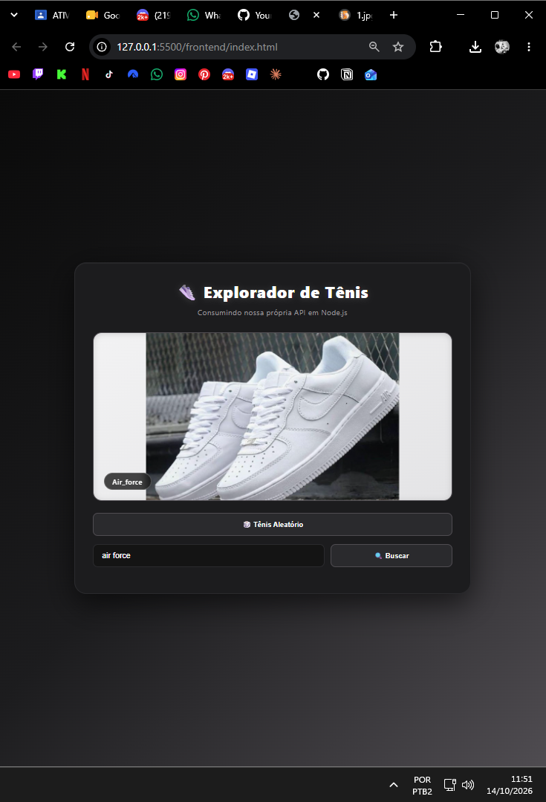
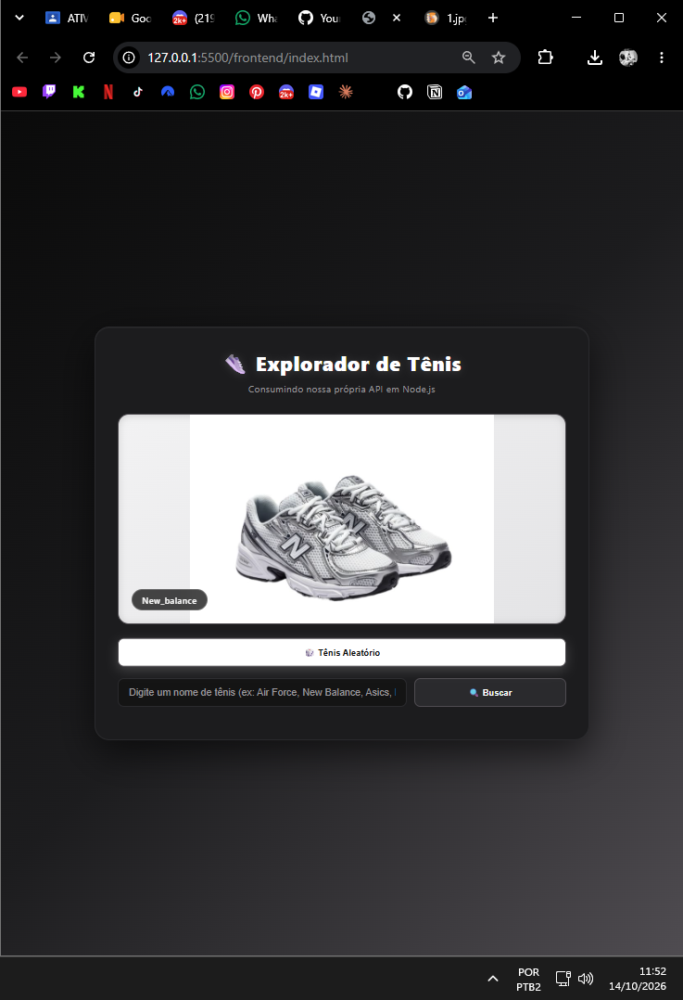
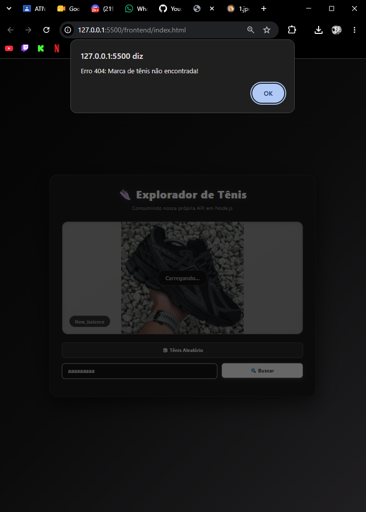

# API Create - Tênis

Descrição breve do projeto em 2 ou 3 linhas, explicando sua finalidade e suas principais funcionalidades.

## Como executar o projeto

1. Instale o Node.js.
2. Abra o terminal na pasta do projeto e execute:

```bash
npm install
node server.js
```

3. Abra o arquivo `index.html` no navegador.

## Rotas da API

| Método | Rota | Descrição |
|---|---|---|
| GET | `/api/...` | Descrição da rota |
| POST | `/api/...` | Descrição da rota |
| PUT | `/api/...` | Descrição da rota |
| DELETE | `/api/...` | Descrição da rota |

## Categorias disponíveis

- Air Force 1
- Asics
- New Balance
- Louis Vuitton

## Prints do projeto

### Busca Válida


### Busca Aleatória


### Busca Error 404


## Autor

**Nome:** Pietro da Silva Pansani <br>
**Turma:** DSI1-SESI
